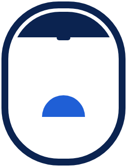

<p align="center"></p>

# A to F — Every seat gets the view

Which side of the plane has the view? **A to F** tells JetBlue flyers whether to sit on the left (A) or the right (F)
for the sunset, the sunrise and the landmarks on their route, gives anyone who can't see out (middle or aisle seat, blind down, night flight) a Virtual Window, and lists the camera moments: when to film or take a photo.

> Independent student project for JetBlue flyers. **Not affiliated with or endorsed by JetBlue Airways.**

## Why
I spent two years as a KLM gate agent at Schiphol. The question passengers asked me most was "which side has the view?"
This project answers it with geometry, not guesswork — and then makes sure every seat gets the view.

## How it works
1. **Track** — the flight path (OpenSky ADS-B history; a labelled great-circle approximation until real tracks load).
2. **Sun geometry** — for every minute of the flight: sun azimuth and elevation at the plane, the horizon dip at
   cruise altitude, and the sun's bearing relative to the nose. Left of the nose is A, right is F.
3. **Recommendation** — sunset/sunrise side if there is golden light; otherwise the shade side for glare-free,
   front-lit views; landmarks decide the rest.
4. **Claude narrates, geometry decides.** Every side claim is checked against the engine before it ships.

## Try it

- Site: **https://a-to-f.vercel.app**
- MCP server (stateless StreamableHTTP): `https://a-to-f-mcp.vercel.app/mcp`
- Claude plugin: `plugin/a-to-f-trip-planner`

## What's in the repo

| Folder | What |
|---|---|
| `pipeline/` | Python engine, landmarks, data builders, evaluation, narration, claim checker, tests |
| `web/` | Next.js site: planner, Virtual Window (CesiumJS), postcard, insights; TypeScript engine port |
| `mcp_server/` | MCP server: progress, logging, sampling, roots; `main.py` hosts it on Vercel |
| `.claude/` | Skills, subagents and hooks used to build and check the project with Claude Code |
| `plugin/` | Cowork plugin for trip planners |
| `.github/workflows/` | CI, Claude Code PR review, Claude data generation |

## Run it
```bash
python3 -m venv .venv && source .venv/bin/activate
pip install -r pipeline/requirements.txt -r mcp_server/requirements.txt
python -m pytest pipeline -q
python pipeline/build_data.py --date 2026-11-12
cd web && npm install && npm run dev
```

## Data and credits
Sun positions computed with [astral](https://github.com/sffjunkie/astral). Flight tracks: The OpenSky Network
(research use). Landmarks: OpenStreetMap contributors / Wikidata. Built with Claude Code for the
ieNYC × DataCamp "Be a Master in Claude" challenge.
